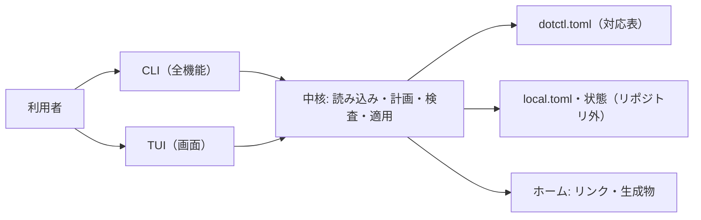

# dotctl 設計（自前ツール）

> 状態: 承認済み（2026-10-25、DESIGN-2）。本ファイルを **dotctl 仕様の正本**とする。変更する場合は本ファイルを更新し、大きな判断の変更は ADR を追加してから行う。
> 機能要求は [product.md](./product.md)、実装の段階計画は [`../planning/TOOL_PLAN.md`](../planning/TOOL_PLAN.md)、進捗は [`../task-list.md`](../task-list.md) を参照する。

2026-10-25 の設計質問で確定した事項:

| 論点 | 決定 |
|---|---|
| ツール名・コマンド名 | `dotctl`（ソースはリポジトリ直下の `tool/`、Bun + TypeScript） |
| 対応表の形式 | TOML（リポジトリ直下の `dotctl.toml`） |
| テンプレート方式 | 変数置換のみ（条件分岐・繰り返しのロジックは入れない） |
| 実装順序 | 段階型: 中核 CLI → パイロット移行 → テンプレート/変更時スクリプト → 引っ越し → 暗号化 → TUI |
| 対象 OS | 当面は WSL Ubuntu のみ（将来の Linux 一般化を妨げない作りにする） |
| パイロット移行 | `starship.toml` 1 件から始め、次に zsh 一式へ広げる |

## 1. 目的と範囲

dotctl は、本リポジトリに置いた設定の実体をホームへ配置（原則シンボリックリンク）し、配置状態の検査・表示、端末差分の生成、変更時スクリプト、新端末への引っ越し案内、暗号化保存を行うツールである。chezmoi の設計（計画してから適用する、テンプレート、変更時スクリプト、暗号化）を参考にするが、互換性は目指さず、コードは新規に書く。

前提の合意（`../../AGENTS.md` §6.4）:

- 実体はリポジトリ側に 1 つだけ置き、ホームからは**一方向のリンク**を張る。ホーム側を編集すると Git 差分になり、`git pull` がそのまま反映されることが中核の価値である。
- 既存の実ファイルがある場所には勝手にリンクを張らない（停止する）。取り込みはバックアップ付きの別操作（`adopt`）にする。
- 秘密情報の平文はリポジトリに置かない。SSH 秘密鍵は暗号化保存の対象にもしない。

## 2. 全体構成

頭脳を UI なしの中核（Core）に寄せ、CLI と TUI は同じ中核と同じ設定ファイルを使う。TUI だけに存在する設定経路は作らない。



リポジトリ内の配置（実装時に作成する）:

```text
wsl-home/
├── dotctl.toml        # 対応表（個人情報は書かない）
├── tool/              # dotctl 本体（Bun + TypeScript）
├── zsh/               # 配置対象の実体（カテゴリ別）
├── config/
├── git/
├── etc/
└── secrets/           # 暗号文（*.age。暗号化フェーズ以降。平文は置かない）
```

ホーム側に置く dotctl 用ファイル（リポジトリ外、Git 管理しない）:

| パス | 内容 |
|---|---|
| `~/.config/dotctl/local.toml` | 端末固有設定（テンプレート変数、復号鍵の場所など）。`XDG_CONFIG_HOME` を尊重する |
| `~/.local/state/dotctl/state.json` | 実行状態（変更時スクリプトの前回ハッシュ、最終適用日時）。`XDG_STATE_HOME` を尊重する |
| `~/.config/dotctl/age-key.txt` | age の identity（復号鍵）。暗号化フェーズ以降。権限 600 の検査対象 |

## 3. 配置モデルと安全規則

- **計画と適用を分ける**。中核はまず「何をするか」の計画（作成・更新・実行・競合）を計算して表示し、適用は計画の実行として行う。計画に競合が 1 つでもあれば適用しない。
- **停止規則**: 配置先に、dotctl が張ったリンク以外のもの（通常ファイル、他を指すリンク、ディレクトリ）がある場合は競合として停止する。上書き・削除はしない。
- **冪等性**: 既に正しいリンクがある場合は何もしない。親ディレクトリが無い場合だけ作成する。
- **書き込み範囲**はホーム配下とリポジトリ配下に限る。対応表の配置先はホーム相対で記述し、`..` などでホーム外へ出る指定は読み込み時点で拒否する。`sudo` は使わない。
- **対象 HOME の選び方**: `--home <dir>` → 環境変数 `DOTCTL_HOME` → `$HOME` の順。テストは一時ディレクトリを `--home` に渡して実ホームに触れない。
- リンクが通常ファイルに置き換わっていた場合の復旧（差分確認 → 変更の取り込み → バックアップ → リンク再作成）は自動化せず、`check` が検出して手順を案内する（前提知識は [`.agent/skills/wsl-dotfiles`](../../.agent/skills/wsl-dotfiles/SKILL.md)）。

## 4. 対応表（`dotctl.toml`）

形式は TOML。スキーマの版数を持ち、未知のキーは読み込み時にエラーにする（タイポを早期に見つけるため）。

```toml
version = 1

[[entries]]
source = "config/starship.toml"   # リポジトリ相対
target = ".config/starship.toml"  # ホーム相対
type = "link"                     # link / template / script / encrypted

[[entries]]
source = "git/config.tmpl"
target = ".gitconfig"
type = "template"
```

| フィールド | 意味 |
|---|---|
| `version` | 対応表スキーマの版 |
| `source` | 実体のリポジトリ相対パス。リポジトリ外は不可 |
| `target` | ホーム相対パス。ホーム外へ出る指定は不可 |
| `type` | `link`（既定）/ `template`（生成物）/ `script`（変更時実行）/ `encrypted`（暗号文の復号配置） |

**個人情報は対応表に書かない**（本リポジトリは公開で運用する。§13 参照）。テンプレート変数の「値」は `local.toml` 側にだけ書き、対応表とテンプレート実体には変数名だけを書く。名前とメールアドレス、実メールアドレス等を含む既存設定を取り込む場合は、変数化してから対応表に載せる。

## 5. ローカル設定と状態

`local.toml`（`init` が雛形を作成する）:

```toml
[vars]
git_name = "..."
git_email = "..."

[encryption]
identity = "~/.config/dotctl/age-key.txt"
recipients = ["age1..."]   # 公開鍵。秘密ではない
```

- `local.toml` は端末ごとに異なり、Git 管理しない。実メールアドレス等の個人情報を含み得るため、dotctl は内容をログやエラーへ出さない。
- `state.json` は一時ファイルへ書いてから置換する原子的書き換えとし、破損時は「状態なし」として再計算する（スクリプトが再実行される側に倒れる）。

## 6. テンプレート

- 置換は「`{{ 変数名 }}`」の形（`git_name` のような識別子、ドット区切りの入れ子）だけを行う。**条件分岐・繰り返し・式の評価は行わない**（2026-10-25 決定）。端末差分は変数の値で吸収し、差分が構造に及ぶ場合は実体ファイルを分ける。
- 未定義の変数はエラーにする（空文字で埋めない）。変数値は `local.toml` の `[vars]` からのみ取る。
- テンプレート対象はリンクではなく**生成物**になる。生成物が手で編集されていた場合（再生成した内容と異なる）は計画でドリフトとして示し、適用時は停止して実体の編集を案内する（`--force` 指定時のみ再生成で上書き）。
- 編集導線として `dotctl edit` を用意し、配置先ではなく実体を開く（§8）。

## 7. 変更時スクリプト

- `type = "script"` のエントリは、実体ファイルの内容ハッシュが `state.json` の記録と異なる場合に、配置の後で 1 回だけ実行する。実行予定は計画に含める。
- 実行はファイルの shebang に従い、無ければ `sh` で実行する。スクリプトが 0 以外で終わったら全体を失敗とし、状態は更新しない（次回再実行される）。
- 想定用途は、設定変更に追随する再構築や再読み込みである。パッケージのインストールや `sudo` が要る操作は対象外とし、どうしても必要な場合はスクリプト側の責任として理由を実体にコメントする。

## 8. コマンド体系

| コマンド | 用途 | 書き込み |
|---|---|---|
| `dotctl init` | 新端末の初期設定を案内（`local.toml` 作成 → 計画確認 → 適用 → 次手順の案内）。§9 | あり（各段で確認） |
| `dotctl plan` | 配置計画の表示のみ（ドライラン） | なし |
| `dotctl apply` | 計画の実行。確認プロンプトあり（`--yes` で省略）。`--dry-run` は `plan` と同じ | あり |
| `dotctl status` | エントリごとの状態（正常 / 未配置 / ドリフト / 競合 / スクリプト実行待ち） | なし |
| `dotctl check` | 検査（対応表の妥当性、リンクの解決先、生成物のドリフト、復号鍵の権限）。問題があれば非 0 終了 | なし |
| `dotctl adopt <配置先...>` | 既存の実ファイルを取り込む（バックアップ → 実体へ移動 → リンク化 → 対応表への追記案を提示） | あり |
| `dotctl edit <配置先 or 実体>` | 対応する実体を `$EDITOR` で開く（生成物・暗号文も実体側を開く導線） | 編集のみ |
| `dotctl secret add/list/edit` | 暗号化保存の操作（§10、暗号化フェーズ） | あり |
| `dotctl tui` | 画面の起動（§11、TUI フェーズ） | 操作次第 |

共通の約束:

- 全コマンドは端末なし（パイプ・自動実行）でも動く。対話確認が要る操作は、非端末では `--yes` が無い限り何もせずに失敗する。
- `plan` / `status` / `check` は `--json` で機械可読な出力に対応する（TUI とスクリプトの再利用のため）。
- リポジトリの場所は `--repo <dir>` → 環境変数 `DOTCTL_REPO` → 現在地から上方探索（`dotctl.toml` がある場所）の順で決め、clone 場所を固定しない。
- 終了コードは 0 = 成功、1 = 競合・検査失敗・ドリフト、2 = 使い方や設定の誤り、とする。
- `adopt` のバックアップ先は `~/.config-backups/dotctl-<日時>/` とし、人が後から比較できる形で残す。`adopt` は秘密情報らしいファイル（SSH 秘密鍵、`.env`、履歴など）を対象に指定された場合は拒否する。

## 9. 引っ越し（`init`）

新端末での流れ（`init` が案内する範囲）:

1. リポジトリを clone し、`tool/` で依存を用意する（Bun が必要。導入自体は mise 等の範囲であり dotctl は案内のみ）。
2. `local.toml` の雛形を作成し、変数の入力を求める（入力値はローカルにのみ保存）。
3. `plan` を表示してから `apply` する。
4. 後続手順のチェックリストを表示する: SSH 鍵は**端末ごとに新規作成**して公開鍵を登録する（実行は案内のみ、自動化しない）、暗号化を使う場合は identity の安全な持ち込み（§10）、パッケージやランタイムの用意（`nala` / `mise`、dotctl の範囲外として運用文書へ誘導）。

dotctl はパッケージのインストールを行わない。理由は、許可のない変更や環境破壊を避け、既存の管理方法（`nala` / `mise` / `uv`）と混線させないためである。

## 10. 暗号化保存

- 形式は age、実装は TypeScript の `age-encryption`（Bun 動作が公式にうたわれている）を第一候補とし、着手時に版と互換を再確認する。
- 暗号化は受取人（公開鍵）方式とする。暗号文は `secrets/*.age` としてリポジトリに置き、復号鍵（identity）はリポジトリ外（§2）に置く。配置時は復号して通常ファイル（権限 600）として置く。暗号文はリンクにしない。
- `secret add` は、SSH 秘密鍵（パスや「PRIVATE KEY」ヘッダで検出）を対象にしたら拒否する（SSH 秘密鍵は端末ごとに作り直す運用。2026-10-19 決定）。
- identity の端末間移動は自動化しない。パスワードマネージャ等の安全な経路で本人が運ぶ手順を運用文書（`docs/ops/`）に記録する。identity を失うと暗号文は復号できなくなるため、`init` の案内でも明示する。
- 暗号文を**公開中**のリポジトリに置くかは暗号化フェーズ開始時に再判断する（§13）。判断までは暗号文を置かない。

## 11. TUI

- 画面の第一候補は OpenTUI、確定は Bun 実行の実証（SPIKE-1）と小さな試作の以後とする。Bun の道が塞がれた場合の代替として Ink（Node + React）を記録しておく。
- 画面は次の 5 つを基本単位とする: 状態ダッシュボード、計画プレビューと適用、対応表エントリの追加・編集、ローカル変数の編集、暗号化保存の管理。
- TUI も中核の同じ計画・確認規則を通す。`adopt` のような書き込み操作は TUI でも必ず確認を挟む。

## 12. `gg` の取り扱い

- `gg` は dotctl に取り込まず、当面は**独立した zsh 関数**として実体（`zsh/` 配下）を管理する。再実装する場合は操作感は参照リポジトリに寄せるが、完全互換は約束しない。
- 安全性の修正を含める: 自動 push の類は既定値にしない（そもそも初期は持たない）、履歴を書き換える操作は説明と確認を挟む、「コミット済みだが未 push」だけの状態で push 系が何もしない癖は直す、失敗時は非 0 で終わる。
- `gg` の設定ファイル（`~/.config/gg/config`）は書き換え方式の都合でリンク対象にせず、ローカル専用のまま Git 管理しない。
- dotctl への統合（サブコマンド化）は TUI の後で再判断する。

## 13. 対象 OS・公開範囲・その他の扱い

| 論点 | 扱い |
|---|---|
| 対象 OS | 当面は WSL Ubuntu のみ。中核は XDG と POSIX パス前提で WSL 固有の前提を持たず、将来の素の Linux 対応を設計で妨げない。macOS は対象外（将来再判断） |
| リポジトリの公開 | 現行の公開を維持し、「秘密情報は一切置かない」前提（`AGENTS.md` §6.3）を続ける。暗号文の公開可否だけ暗号化フェーズ開始時に再判断し、判断までは暗号文を置かない |
| 最初の移行範囲 | パイロットは `starship.toml`（現在の見た目は一切変えない）。次に zsh 一式（プラグイン導入後の現行 `.zshrc` を取得してから）。以降は使用感を見て広げる |
| 実環境への適用 | AI はリポジトリ変更まで。実環境での配置・取り込み（`apply` / `adopt` の実実行）は本人が承認・実行する（`AGENTS.md` §6.2） |
| Bun の版 | AI 作業環境では npm パッケージ経由の Bun 1.4.4 が動作（2026-10-25、SPIKE-1 で実測。組み込み TOML 解析とテスト実行を確認）。版の下限は TOOL-1 で `tool/package.json` に記録する。Node フォールバックは初期範囲外 |

## 14. テストと検証

- 単体: 対応表の読み込みと検証、計画の計算、テンプレート置換、状態の読み書き。Bun 標準のテスト実行を使う。
- 結合: 一時ディレクトリを HOME とリポジトリに見立て、`plan` → `apply` → `status` / `check` の往復、競合時の停止、`adopt` のバックアップ、変更時スクリプトの再実行条件を確かめる。**実ホームには触れない**。
- 実環境: パイロット移行（starship → 次に zsh）で、配置 → ホーム側編集が Git 差分になること → `git pull` の反映 → `check` の一連を本人が確認する。VS Code で保存した際にリンクが保たれることもここで見る。
- 具体的な検証コマンドは実装時に `AGENTS.md` §6.1 と `Makefile` の `PROJECT_CHECKS` へ記録してから使い始める。

## 15. 段階計画

段階・サブタスク・完了条件の詳細は [`TOOL_PLAN.md`](../planning/TOOL_PLAN.md) を正とする。対応関係の要約:

| 段階 | タスク | 出口 |
|---|---|---|
| 中核 CLI | TOOL-1 | 一時 HOME で 配置・検査・状態表示が一周する |
| パイロット移行 | MIG-1 | starship が実環境でリンク化され、往復が確認できる |
| テンプレート / 変更時スクリプト | TOOL-2 | 変数置換とスクリプト再実行条件がテストで担保される |
| 引っ越し | TOOL-3 | 新規環境（模擬）で `init` から配置まで一周する |
| 暗号化 | TOOL-4 | 暗号化 → 復号配置 → 編集導線が一周する |
| TUI | TOOL-5 | 画面から CLI と同じ設定を編集・適用できる |

## 16. リスクと留意点

- エディタの原子的保存などでリンクが通常ファイルに置き換わることがある。`check` で検出し、復旧手順に従う（§3）。パイロットで VS Code の保存挙動を確認する。
- 生成物（テンプレート・暗号文）はホーム側を編集しても Git 差分にならない。対象は最小限にし、`edit` で実体へ誘導する。
- age identity の紛失は暗号文の喪失に直結する。作成時に安全な控えを案内する。
- Bun の版差・AI 作業環境での実行可否は SPIKE-1 で実測してから中核実装に入る。

## 17. 非目標

- chezmoi との互換性、双方向同期や常駐デーモン、`sudo` が要る変更、パッケージやランタイムのインストール自動化、SSH 秘密鍵の暗号化引っ越し、Windows 側の設定管理、ホーム全体や履歴の Git 管理。
